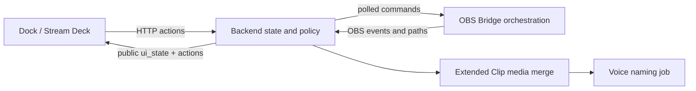

# Доменная онтология

[[README|К карте спецификации]]

## Назначение системы

SayClip управляет сохранением файла из OBS и последующим голосовым именованием. Базовые варианты — сохранить Replay Buffer как **Moment** и остановить текущую OBS Recording как **Recording**. Целевой вариант **Extended Clip** соединяет сохранённый Replay Buffer с продолжением Recording, чтобы получить один длинный клип без перекодирования.

## Основные сущности

| Сущность | Смысл | Владелец |
|---|---|---|
| `BackendApi` | Каноническое состояние, доступность действий и HTTP-команды | backend |
| `BridgeCommand` | Одна команда backend → OBS Bridge с результатом | backend + bridge |
| `OBS State Snapshot` | Свежий heartbeat о Recording и Replay Buffer | bridge |
| `NamingJob` | Захват голоса, STT и переименование одного готового media-файла | backend |
| `ExtendedClipSession` | Единственная активная попытка создать Extended Clip | backend |
| `ExtendedClipPhase` | Подробная внутренняя фаза session | backend |
| `PublicUiState` | Стабильное крупное состояние для любого UI | backend contract |
| `ActionAvailability` | Разрешено ли конкретное действие и почему нет | backend contract |
| `MergeDiagnostics` | Техническое доказательство overlap и validation | media layer |

## Ограниченные контексты

### Consumer UI

Dock и будущий Stream Deck **MUST** отображать состояние backend, а не вести собственный автомат. Consumer знает только [[02-public-status-and-actions|публичное состояние и доступность действий]].

### Backend policy

Backend — единственный авторитет по наличию `ExtendedClipSession`, конфликтам операций и разрешённым действиям. В один момент **MUST** существовать не более одной session.

### OBS orchestration

Bridge вызывает OBS API, слушает frontend events и сообщает точные пути файлов. Bridge **MUST NOT** выполнять media merge или voice naming.

### Media merge

Media layer сопоставляет пакеты, создаёт output через stream copy и валидирует результат. Он **MUST NOT** перекодировать audio или video в MVP.

### Naming

Только успешно слитый и проверенный Extended Clip передаётся в существующий voice naming pipeline как job type `extended_clip`.

## Состояние и идентичность

- Клиенту **MUST NOT** требоваться `session_id` для Start, Finish или Cancel.
- Backend **MUST** сам адресовать единственную активную `ExtendedClipSession`.
- Session **MUST** помнить, принадлежит ли Recording именно ей. Это запрещает остановить чужую запись.
- Runtime JSON **SHOULD** храниться в папке данных SayClip для диагностики.
- После рестарта runtime JSON **MUST NOT** возобновлять session. Recovery не входит в MVP.

## Связанные документы

- Жизненный цикл: [[03-extended-clip]]
- Внешний контракт: [[02-public-status-and-actions]] и [[04-api-contract]]
- Работа с файлами: [[05-media-merge]] и [[06-failures-and-file-safety]]
